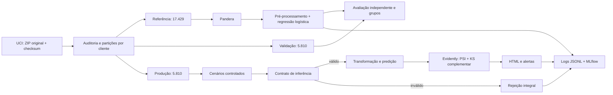

# Tech Challenge — Fase 4

Observabilidade contínua, qualidade de dados, data/concept drift e governança de um modelo de risco de crédito.

**Situação:** implementação técnica executada com dados reais e cenários simulados. Vídeo STAR e submissão por Ygor ainda pendentes. Trabalho individual; prazo 11/11/2026, meta interna de entrega 09/11.

## Resultado demonstrado

| Cenário | Resultado real |
| --- | --- |
| Controle | 5.810 predições; nenhuma feature com PSI ≥0,2 |
| Lote inválido | 5.810 registros rejeitados integralmente; zero predições; run MLflow FAILED |
| Drift moderado/severo | Mudanças detectadas em `limit_bal` e `pay_0`; dois alertas por lote |
| Concept drift sintético | Mesmos X do controle, rótulos modificados; ROC-AUC 0,771 → 0,491; alerta de desempenho |

O baseline obteve ROC-AUC **0,766**, PR-AUC **0,525**, precision **0,673** e recall **0,364** na validação independente, com limiar 0,5. O baseline ingênuo obteve ROC-AUC 0,5 e PR-AUC 0,215. O recall baixo limita o uso: este projeto demonstra sustentação e diagnóstico, sem validar decisões reais de concessão.

- [Evidências de execução e reprodução](docs/validacao.md)
- [Auditoria da base](docs/dataset.md) e [avaliação agregada](reports/evidence/training.json)
- [Atividades no GitHub](docs/issues.md), [plano](docs/planejamento.md) e [cronograma](docs/cronograma.md)
- [Mapa da rubrica](docs/criterios.md)

## Executar

Pré-requisitos: Git e [uv](https://docs.astral.sh/uv/getting-started/installation/), com acesso à internet na primeira instalação e aquisição. Python 3.12; dependências de produção e desenvolvimento separadas no `pyproject.toml`, versões exatas no `uv.lock`.

```sh
git clone --branch chore/project-scaffold https://github.com/ygormartinelli/tech-challenge-fase-4.git
cd tech-challenge-fase-4
uv sync --locked
uv run credit-monitor run
```

O comando baixa a fonte pública, verifica origem/checksum, audita, separa clientes, treina o modelo, executa cinco cenários e grava relatórios e runs no MLflow. A primeira execução precisa de rede; as seguintes reaproveitam o ZIP local conferido por checksum. Cada execução ganha uma pasta própria.

Comandos isolados:

```sh
uv run credit-monitor audit
uv run credit-monitor train
uv run ruff check
uv run ruff format --check
uv run pytest -q
```

`train` requer as partições criadas por `audit`. Os comandos devem partir da raiz do repositório; alternativamente, passe `--root CAMINHO` ao CLI.

## Ver os resultados

`reports/generated/latest.json` indica a pasta da última execução. Nela, abra `index.html` para o resumo e os links para os relatórios Evidently, ou sirva os HTML localmente:

```sh
uv run python -m http.server 8765 --bind 127.0.0.1 --directory reports/generated
```

Abra `http://127.0.0.1:8765/<execution_id>/index.html`, substituindo o identificador pelo de `latest.json`. Em outro terminal, abra o rastreamento:

```sh
uv run mlflow server --backend-store-uri sqlite:///mlflow.db --host 127.0.0.1 --port 5000 --workers 1
```

Acesse `http://127.0.0.1:5000`, selecione **Model training → credit-monitoring → Runs** e expanda o run pai para ver os cenários. Inspecione métricas, status e artefatos. Encerre os servidores com Ctrl+C após uso. O aviso sobre execução de jobs no Windows não afeta o rastreamento usado pelo projeto.

## Arquitetura



Pandera bloqueia lote vazio, nulos, IDs repetidos, campos ausentes/extras e violações de domínio: idade adulta, limite positivo, pagamentos não negativos e códigos válidos. Treino exige alvo binário; inferência não exige alvo. Faturas negativas são permitidas conforme a fonte.

O pré-processamento ajustado no treino combina signed-log/padronização dos valores monetários e one-hot dos status de pagamento. Não usa ID, alvo ou atributos demográficos como features. Consulte [decisões de arquitetura](docs/arquitetura.md).

## Dados e validade

[UCI Default of Credit Card Clients](https://archive.ics.uci.edu/dataset/350/default+of+credit+card+clients), licença CC BY 4.0. Atribuição: Yeh, I. (2009), DOI [10.24432/C55S3H](https://doi.org/10.24432/C55S3H). São 30.000 clientes, com alvo real de inadimplência de cartão. Após excluir todos os 951 membros de perfis financeiros repetidos, restam **29.049** observações. Essa política conservadora modifica a população; não houve duplicação artificial para atingir a quantidade mínima.

Dados históricos de Taiwan não validam automaticamente crédito no Brasil. Meses nas colunas não são clientes novos nem uma separação temporal real. As janelas de produção são simulações sobre um conjunto de clientes separado do treino e da validação, com seed 42. As contagens dos cenários não devem ser somadas como novos clientes independentes.

## Drift, causalidade e prescrição

O Evidently calcula PSI por feature, com limiar 0,2 e alerta global a partir de uma das 19 features afetadas. KS com Bonferroni é complementar. A [política operacional](docs/operacao.md) explica métricas, unidades e limitações.

Data drift altera limite de crédito e código de atraso, mantendo o contrato. Não avaliamos acurácia contra rótulos originais após manipular X, pois não observamos o resultado contrafactual.

Concept drift é demonstrado separadamente: com X idêntico ao controle, invertemos o rótulo com probabilidade 0,8 nos casos `pay_0 <= 0` e fatura mais recente acima da mediana de referência. O mecanismo muda P(y|X), mantém os rótulos reais intactos e identifica a avaliação como sintética. A queda observada é consequência desse experimento, não descoberta de uma mudança econômica real.

Hipótese de negócio: choques econômicos podem alterar atrasos, limite disponível e inadimplência. Renda, seleção de clientes, política de concessão e acesso ao crédito podem confundir associações; não estão controlados nesta base. Para investigar causalidade real, seriam necessários dados longitudinais, fatores de confusão relevantes e desenho causal justificável. PSI/KS e correlação não identificam efeitos causais.

Ação: rejeitar lotes inválidos; investigar drift e coleta; avaliar desempenho quando rótulos chegarem; revisar custos e grupos; propor retreinamento somente após validação independente. Não há retreinamento automático nem decisão real de concessão.

## Governança e privacidade

Responsável acadêmico: Ygor. Finalidade: demonstrar confiabilidade com base pública licenciada. Não coletamos novos dados pessoais nem tentamos reidentificar clientes. ID fica local para integridade; não entra nas features ou nos relatórios públicos. Idade, sexo e histórico financeiro podem permitir inferências sobre pessoas; ausência de nome/CPF não comprova anonimização. Não equiparamos todo atributo demográfico a dado sensível na definição jurídica.

**Base legal contextualizada:** no cenário hipotético de crédito, o art. 7º, X contempla proteção do crédito; isso não autoriza usos ilimitados. Uso acadêmico não dispensa análise dos arts. 7º e 11 (art. 4º, II, b), nem torna automaticamente o estudante um órgão de pesquisa. Para eventual tratamento de dados pessoais neste estudo, legítimo interesse exigiria avaliação concreta de finalidade, necessidade, expectativas e direitos; não afirmamos que a licença substitui essa avaliação. A ANPD orienta o uso de hipótese adequada ao caso por pesquisadores não enquadrados como órgão de pesquisa. Decisões automatizadas também exigem atenção aos direitos do art. 20. Referências: [LGPD atualizada](https://www2.camara.leg.br/legin/fed/lei/2018/lei-13709-14-agosto-2018-787077-normaatualizada-pl.html) e [orientação da ANPD](https://www.gov.br/anpd/pt-br/assuntos/noticias/anpd-lanca-guia-orientativo-sobre-tratamento-de-dados-pessoais-para-fins-academicos). Não se declara conformidade jurídica certificada.

**Minimização e proteção implementadas:** dados brutos/processados, modelos, banco MLflow e logs fora do Git; erros mostram apenas regras; HTML e JSON públicos são agregados; atributos demográficos excluídos do modelo; serviços ligados somente a localhost. A licença é preservada por atribuição. O repositório não contém credenciais ou `.env`. Controle de acesso do dispositivo e backups são responsabilidades operacionais, não garantias verificadas pelo código.

**Retenção proposta:** Ygor revisará a necessidade dos dados locais até 30 dias após encerramento da avaliação e recursos acadêmicos. Encerrada a finalidade, excluir dados brutos/processados, modelos, logs, banco MLflow, artefatos e respectivas cópias de teste/backups; registrar data, escopo e eventual justificativa de retenção. Código e evidências agregadas podem permanecer no portfólio após revisão. Esse é um procedimento documentado; nenhuma exclusão foi executada automaticamente.

**Vieses:** na validação, recall por sexo codificado 1/2 foi 0,358/0,369, com IC95% de Wilson [0,320;0,399]/[0,334;0,405]. Por idade, recall foi 0,384 (18–29), 0,345 (30–44) e 0,373 (45+). Tamanhos, prevalência e intervalos estão no relatório. A sobreposição de intervalos não prova equivalência; retirar atributos não elimina proxies. Mitigações propostas: revisão de representatividade, custos por grupo, limiar validado e acompanhamento com novas amostras. Não há evidência de equidade em população brasileira.

## Organização e histórico

- `src/credit_monitoring/`: aquisição, contratos, modelo, simulação, drift, pipeline e telemetria.
- `configs/`: parâmetros do experimento; `tests/`: contratos e integração.
- `reports/evidence/`: resultados agregados e capturas revisadas; `reports/generated/`: saídas locais.
- `docs/`: decisões, aceite, operação e preparação da entrega.
- `data/`, `models/`, `logs/`, `mlartifacts/`: dados e artefatos locais ignorados.

Commits semânticos, incluindo WIP e correções verificadas, preservam o desenvolvimento. A CI testa lint, formatação, contratos, separação e relatório Evidently com fixtures artificiais pequenas, em Windows e Linux. Ela não apresenta essas fixtures como base acadêmica. A reprodução com a base real é validada separadamente e documentada. O vídeo permanece pendente; o link será destacado no início deste README quando disponível.
